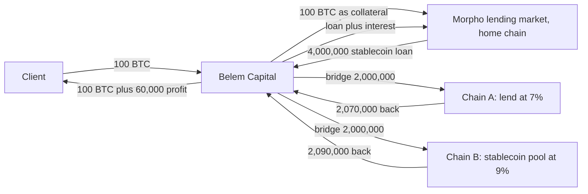
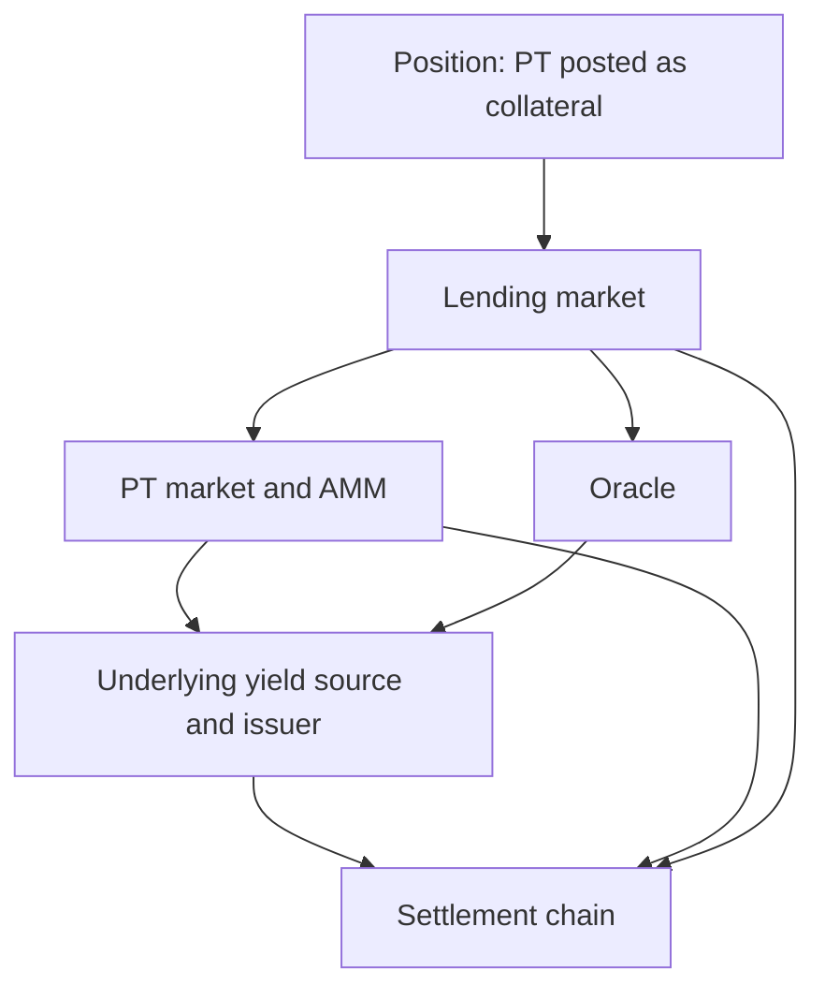
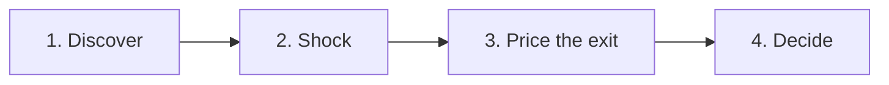

# DeFi Dependency Risk Engine

**EPFL Hackathon 2026 · Belem Capital challenge track: "DeFi Risk Dependency Challenge"**

> Turn a tangled web of on-chain dependencies into one number a portfolio manager can act on: stay, or get out.

This README has two halves:

1. **The background** (sections 1 to 6): how a fund like Belem Capital earns money, written for readers with no finance background, with a full worked example that tracks every dollar.
2. **The project** (sections 7 to 12): what we build, how it works, and how it maps to the judging criteria.

A glossary of every term used is in [section 13](#13-glossary).

> **Read this first.** Belem Capital publishes the *types* of strategy it runs, not its exact trades. Everything in sections 3 and 4 is a teaching example with round, invented numbers. It shows the mechanism, not Belem's real book, rates or returns. Nothing here is investment advice.

---

## Table of contents

1. [Who Belem Capital is](#1-who-belem-capital-is)
2. [The core idea: earn without betting on the price](#2-the-core-idea-earn-without-betting-on-the-price)
3. [The building blocks](#3-the-building-blocks)
4. [Worked example: following 100 BTC](#4-worked-example-following-100-btc)
5. [Where the profit comes from, in one paragraph](#5-where-the-profit-comes-from-in-one-paragraph)
6. [What can go wrong: the dependencies](#6-what-can-go-wrong-the-dependencies)
7. [The challenge](#7-the-challenge)
8. [Our solution](#8-our-solution)
9. [The decision rule](#9-the-decision-rule) (and [daily monitoring](#91-daily-monitoring))
10. [Architecture and data sources](#10-architecture-and-data-sources)
11. [Repository layout and running it](#11-repository-layout-and-running-it)
12. [Limitations](#12-limitations)
13. [Glossary](#13-glossary)
14. [Sources](#14-sources)

---

## 1. Who Belem Capital is

Belem Capital is a Luxembourg-based on-chain asset manager for professional and institutional investors. Clients hand over money or crypto, and Belem puts it to work on blockchain-based financial applications ("DeFi") so that it earns a return.

| Fact | Detail | Source |
|---|---|---|
| What it runs | Market-neutral yield strategies across stablecoin, ETH, BTC and SOL mandates | Challenge brief |
| How clients invest | A registered Luxembourg fund, segregated managed accounts, curated vaults | Challenge brief |
| Stated sources of return | Liquidity provision, lending and borrowing, arbitrage | belemcapital.com |
| Client rhythm | Money can go in or out once a month | belemcapital.com |
| Fees | "2/20 with high water-mark" | belemcapital.com |
| Safety record | 0 security incidents, 0 counterparty defaults, 0 liquidations; 39+ protocols and 20+ blockchains monitored | Challenge brief |

**What "2/20" means in plain words.** Belem keeps 2% of the money it manages each year, plus 20% of the profit it makes. If a strategy earns 10% before fees, roughly 2 points go to the management fee, 1.6 points to the profit share, and 6.4 points to the client (simplified; the exact order of calculation is in the fund documents). "High water-mark" means Belem only takes the profit share on *new* highs, so it is not paid twice for recovering an earlier loss.

---

## 2. The core idea: earn without betting on the price

Most people think of crypto investing as "buy it and hope it goes up". Belem does the opposite. It builds positions where a price rise and a price fall cancel out, and what is left over is a small, steady income. That is what **market-neutral** means.

An everyday comparison: a currency exchange booth does not care whether the euro goes up or down. It earns a small margin on every exchange. Belem looks for the crypto equivalents of that margin:

- people paying to borrow,
- traders paying to hold leveraged bets,
- traders paying a fee every time they swap one token for another,
- the same thing being priced differently in two places,
- money being cheap to borrow on one chain and well paid on another.

The price bet is removed. The risk that remains is that **one of the systems the position relies on breaks**. That remaining risk is what this project measures.

---

## 3. The building blocks

Each block has a finance explanation and a plain-words version.

### 3.1 Spot and short

| Term | Finance explanation | Plain words |
|---|---|---|
| **Spot** | Buying the actual asset for immediate delivery. | You buy a Bitcoin and you own it. |
| **Long** | A position that gains when the price rises. | You win if it goes up. |
| **Short** | A position that gains when the price falls. | You win if it goes down. |
| **Hedge** | A second position that offsets the first. | An insurance bet that cancels the first bet. |

Own 1 BTC and short 1 BTC at the same time, and the two cancel:

| BTC price moves | Your BTC | Your short | Together |
|---|---|---|---|
| +$10,000 | +$10,000 | −$10,000 | 0 |
| −$10,000 | −$10,000 | +$10,000 | 0 |

### 3.2 Perpetual futures and the funding rate

A **future** is a contract to trade something later at a price agreed today. A **perpetual future** ("perp") is the same idea with no end date: it is a running bet on the price that you can hold as long as you like.

Because a perp never expires, something has to keep its price close to the real Bitcoin price. That something is the **funding rate**: a small payment exchanged between the two sides every few hours (commonly every 1 or 8 hours).

- When more traders want to bet on a rise, the perp trades above the real price, and **longs pay shorts**.
- When more traders want to bet on a fall, it flips, and **shorts pay longs**.

Plain words: the crowd that is on the popular side pays rent to the crowd on the unpopular side. In crypto, the popular side has usually been "up", so the short side has usually collected the rent. *Usually* is not *always*: funding can turn negative and stay negative for weeks.

### 3.3 The cash-and-carry trade (also called the basis trade)

Put 3.1 and 3.2 together:

1. Buy Bitcoin (spot).
2. Short the same amount of Bitcoin with a perp.
3. Price moves cancel. You collect the funding rate.

Plain words: you hold the real thing and bet against it by the same amount. You no longer care about the price, and you get paid rent for standing on the unpopular side.

"Basis" is simply the gap between the futures price and the spot price. This trade harvests that gap.

### 3.4 Lending and borrowing, and Morpho

A **lending protocol** is a pawn shop run by a computer program. You hand over something valuable (collateral), you receive a loan worth less than what you handed over, and you pay interest. If the value of your collateral falls too far, the program sells it to repay the lender. That forced sale is a **liquidation**.

**Morpho** is one such protocol. It is made of many separate markets, and each market is defined by exactly four choices that never change after creation:

| Parameter | What it is | Plain words |
|---|---|---|
| Collateral asset | What borrowers must deposit | What you leave at the pawn shop |
| Loan asset | What they receive | What you walk out with |
| Oracle | The price feed the market trusts | The price tag the shop reads |
| LLTV | Liquidation loan-to-value | The point where the shop sells your item |

Two ratios matter:

- **LTV (loan-to-value)** = loan ÷ collateral value. Borrow $40 against $100 of collateral and your LTV is 40%.
- **LLTV** is the limit. If the market's LLTV is 86% and your LTV reaches 86%, anyone may repay part of your loan and take your collateral at a discount.

Belem can sit on either side: **lend** stablecoins and earn interest, or **borrow** against client assets to fund another strategy.

### 3.5 Liquidity providing

A **decentralised exchange** has no order book of buyers and sellers. Instead it has a **pool**: a pot holding two tokens. Anyone who wants to swap trades against the pot, and pays a small fee. The people who filled the pot are **liquidity providers**, and they share those fees.

Plain words: you stock the shelves of a self-service exchange booth and take a cut of every exchange.

The catch is **impermanent loss**: if the two tokens move apart in price, the pot ends up holding more of the loser. Market-neutral managers reduce this by choosing pairs that move together (two dollar stablecoins, or Bitcoin and a wrapped version of Bitcoin) or by hedging.

### 3.6 Arbitrage

The same thing is sometimes cheaper in one place than another. Buy where it is cheap, sell where it is expensive, keep the difference. Cash-and-carry is one form of this.

### 3.7 Bridges and working across chains

There are many blockchains, and they do not talk to each other directly. A **bridge** is a service that moves tokens from one chain to another: it locks the token on the first chain and issues a matching token on the second.

Interest rates and trading fees differ from chain to chain, because each has its own borrowers and traders. A manager can borrow where money is cheap and put it to work where it pays more. This is **rate arbitrage**.

Plain words: you take a loan in a town where loans are cheap, drive the cash to a town where people pay more to borrow it, and keep the difference. The bridge is the road, and the road is one more thing that can fail.

### 3.8 Pendle principal tokens

Pendle takes a token that earns a changing yield and splits it into two parts:

- **PT (principal token):** a claim on the original amount at a fixed future date. It trades below face value and climbs to face value by that date, like a savings bond bought at a discount. That discount is a **fixed yield**.
- **YT (yield token):** a claim on the changing yield until that date.

A PT can also be used as collateral in a lending market. That is the example the challenge brief uses, and it is five layers of dependency deep (see [section 6](#6-what-can-go-wrong-the-dependencies)).

---

## 4. Worked example: following 100 BTC

Two versions follow. Version A is the cleanest way to see a market-neutral trade. Version B is the full ledger for a Bitcoin client: Belem borrows stablecoins against the Bitcoin and puts those stablecoins to work on other chains. It does not buy Bitcoin again with the borrowed money.

**Assumptions (all invented, round numbers):**

| Assumption | Value | Used in |
|---|---|---|
| BTC price | $100,000 | A and B |
| Holding period | 6 months | A and B |
| Average funding rate received by shorts | 10% per year | A |
| Interest rate paid on the stablecoin loan | 4.8% per year | B |
| Interest rate earned by lending on Chain A | 7% per year | B |
| Return earned in a stablecoin pool on Chain B | 9% per year | B |
| Bridge and network costs, round trip | $4,000 | B |

Amounts are in US dollars because the main stablecoins are dollar-based. Swap the symbol for € and the story is identical.

### 4.1 Version A: the classic cash-and-carry (dollar client)

A client gives Belem $10,000,000 and wants a dollar return.

| Step | What Belem does | Plain words |
|---|---|---|
| 1 | Buys 100 BTC for $10,000,000 | Buys the real thing |
| 2 | Shorts 100 BTC with a perp (**−100 BTC**) | Bets against it by the same amount |
| 3 | Net Bitcoin exposure: +100 − 100 = **0** | Price no longer matters |
| 4 | Collects funding: 10% × $10,000,000 × ½ year = **+$500,000** | Gets paid rent for six months |
| 5 | Sells the 100 BTC, closes the short | Undoes both bets |

Result before costs and fees: $10,000,000 becomes $10,500,000, whatever Bitcoin did. (Simplified: in practice part of the money must be set aside as margin for the short.)

**Why this version does not suit a Bitcoin client.** If a client hands over 100 BTC and Belem shorts all 100, the client has stopped being a Bitcoin holder. A client in a BTC mandate wants to keep their Bitcoin and earn on top of it. That is version B.

### 4.2 Version B: the full ledger (Bitcoin client, borrow and deploy across chains)

The client sends **100 BTC**. Belem keeps the 100 BTC untouched as collateral, borrows stablecoins against it, and sends those stablecoins to the chains where they earn the most. The trade is a **rate arbitrage**: borrow where money is cheap (4.8%), put it to work where money pays more (7% and 9%), keep the difference.



**The ledger.** Each row shows the balances *after* that step.

| # | What Belem does | Plain words | Client BTC locked | Loan owed | Stablecoins on home chain | On Chain A | On Chain B |
|---|---|---|---|---|---|---|---|
| 0 | Receives 100 BTC from the client | Client hands over the Bitcoin | 100 | $0 | $0 | $0 | $0 |
| 1 | Supplies 100 BTC (worth $10,000,000) as collateral on Morpho | Leaves it at the pawn shop | 100 | $0 | $0 | $0 | $0 |
| 2 | Borrows $4,000,000 of stablecoins (LTV 40%) | Takes a loan worth 40% of it | 100 | $4,000,000 | $4,000,000 | $0 | $0 |
| 3 | Bridges $2,000,000 to Chain A and $2,000,000 to Chain B | Moves the money to where it earns more | 100 | $4,000,000 | $0 | $2,000,000 | $2,000,000 |
| 4 | Lends the $2,000,000 on Chain A at 7% a year | Lends it to other borrowers | 100 | $4,000,000 | $0 | $2,000,000 | $2,000,000 |
| 5 | Puts the $2,000,000 on Chain B into a stablecoin liquidity pool at 9% a year | Stocks an exchange booth and takes a cut | 100 | $4,000,000 | $0 | $2,000,000 | $2,000,000 |
| 6 | Holds 6 months: earns $70,000 on Chain A and $90,000 on Chain B | Collects the income | 100 | $4,000,000 | $0 | $2,070,000 | $2,090,000 |
| 7 | Withdraws both and bridges back, paying $4,000 in bridge and network costs | Brings the money home | 100 | $4,000,000 | $4,156,000 | $0 | $0 |
| 8 | Repays $4,000,000 plus $96,000 interest | Pays back the pawn shop | 100 (released) | $0 | $60,000 | $0 | $0 |
| 9 | Returns the 100 BTC; the $60,000 profit is the client's gain | Hands everything back with the extra | **100 returned** | $0 | **$60,000 profit** | $0 | $0 |

Belem never sells the client's Bitcoin and never buys more. The Bitcoin only serves as the deposit that makes the loan possible. The profit is earned in stablecoins; at $100,000 per BTC it is worth 0.6 BTC.

**Snapshot of what Belem holds and owes after step 5**

| Holds | Value | Owes | Value |
|---|---|---|---|
| 100 BTC locked in Morpho | $10,000,000 | Stablecoin loan to Morpho | $4,000,000 |
| Stablecoins lent on Chain A | $2,000,000 | 100 BTC owed back to the client | $10,000,000 |
| Stablecoins in a pool on Chain B | $2,000,000 | | |
| **Total** | **$14,000,000** | **Total** | **$14,000,000** |

**Profit and loss for the six months**

| Line | Amount | Plain words |
|---|---|---|
| Interest earned on Chain A (7% × $2,000,000 × ½) | +$70,000 | Income from lending |
| Pool income on Chain B (9% × $2,000,000 × ½) | +$90,000 | Income from the exchange booth |
| Interest paid on the loan (4.8% × $4,000,000 × ½) | −$96,000 | Cost of the loan |
| Bridge and network costs | −$4,000 | Cost of moving the money |
| **Net profit before Belem's fees** | **+$60,000** | What is left |
| Worth in Bitcoin at $100,000 | 0.6 BTC | |

The client sent 100 BTC and ends with 100 BTC plus $60,000 before fees: +0.6% in six months, about 1.2% a year on the deposit.

That is small, and deliberately so. Only 40% of the deposit's value was borrowed, and the loan interest ate 60% of the income. A real portfolio combines several income sources at once. This example exists to show the mechanism and the bookkeeping, not to reproduce a real return.

### 4.3 What if the Bitcoin price moves?

Same trade, three different prices at the end of the six months.

| BTC price at the end | Client's Bitcoin | Profit in stablecoins | Profit worth in BTC | LTV of the loan (with interest) |
|---|---|---|---|---|
| $80,000 | 100 | $60,000 | 0.75 | 51.2% |
| $100,000 | 100 | $60,000 | 0.60 | 41.0% |
| $120,000 | 100 | $60,000 | 0.50 | 34.1% |

The profit is the same in every row, because the money at work is stablecoins and does not move with the Bitcoin price. The client still owns 100 BTC throughout, which is what a Bitcoin holder wants.

**The dangers the table does not show:**

- **If the price falls, the loan becomes riskier.** With an LLTV of 86%, liquidation starts at about $46,500 per BTC, a fall of roughly 53%. To avoid it, Belem must repay part of the loan in time.
- **The money needed to repay is on other chains.** It has to be withdrawn and bridged back first. If a bridge is slow or frozen, or a chain is congested, the repayment arrives late.
- **Pulling the money out can be costly.** If many people withdraw from the Chain A lending market or the Chain B pool at once, leaving takes longer or costs more.

All three are about *systems and timing*, not about a price bet. That leads to section 6.

---

## 5. Where the profit comes from, in one paragraph

Belem leaves the client's Bitcoin as a deposit and borrows dollars against it at a low interest rate. It does not buy more Bitcoin. It moves the borrowed dollars to other blockchains where borrowers and traders pay more for them, and lends them out or stocks an exchange pool there. After six months it brings the dollars home, repays the loan and its interest, and what is left over is the profit. The client gets their Bitcoin back, plus that profit.

---

## 6. What can go wrong: the dependencies

A position looks like one line in a spreadsheet: "100 BTC, earning yield". Underneath, it relies on a stack of separate systems. If any one of them fails, the position can lose money even though the trade itself was sound. Each thing a position relies on is a **dependency**.

### 6.1 The six risk families we manage

| # | Risk | Plain words | Where it sits in the worked example |
|---|---|---|---|
| 1 | **Validation (oracle) risk** | The price tag a program reads is wrong, old, or manipulated | Morpho reads an oracle to value the 100 BTC; the Chain A market reads its own |
| 2 | **Token dependency risk** | A token is only worth what stands behind it, and that can be another token | Wrapped Bitcoin depends on its custodian; a bridged stablecoin depends on the original stablecoin and on the bridge |
| 3 | **Liquidation risk** | The collateral is sold by force when its value drops too far | The Morpho loan is liquidated if LTV reaches 86% |
| 4 | **Bridge and cross-chain risk** | The road between two chains is hacked, frozen or slow, or a chain itself stops | The $4,000,000 sits on Chains A and B and must travel back to repay the loan |
| 5 | **Liquidity and exit risk** | You cannot leave quickly without paying heavily | Withdrawing from the Chain A market or the Chain B pool during a rush; this is the 11% in the brief |
| 6 | **Mint (token supply) risk** | Someone creates new tokens with nothing behind them, so every existing token is worth less | The wrapped Bitcoin, the stablecoin and its bridged copies can each be minted by someone; see 6.3 |

Risks 1, 2, 3 and 6 describe how a failure *starts and spreads*. Risks 4 and 5 describe whether Belem can *react in time and at what cost*, which is the stay-or-exit question the challenge asks.

### 6.2 Dependencies of the worked example

| Dependency | What it does for the position | How it can fail | What happens to the money | Risk family |
|---|---|---|---|---|
| **Wrapped Bitcoin** | Stands in for real Bitcoin on the chain Morpho runs on | Its custodian or bridge is hacked or freezes, or tokens are minted without Bitcoin behind them | The token falls below the Bitcoin price; collateral shrinks | 2, 6 |
| **Oracle on Morpho** | Tells Morpho what the collateral is worth | Shows a wrong or outdated price | A healthy loan is liquidated, or bad loans are not | 1 |
| **Morpho market** | Holds the collateral and issues the loan | Bug, or other borrowers leave unpaid debt | Collateral stuck or lost | 3 |
| **Stablecoin** | The borrowed money | Loses its 1:1 link to the dollar, for example after an unbacked mint | The money at work is worth less than the debt | 2, 6 |
| **Bridges** | Move the stablecoins to Chains A and B and back | Hack, freeze, or delay | Money lost in transit, or home too late to prevent liquidation | 4 |
| **Bridged stablecoin** | The form the money takes on the other chain | The bridge behind it fails, or is tricked into issuing copies with nothing locked | The token on that chain loses its value | 2, 4, 6 |
| **Chain A lending market** | Earns the 7% | Its oracle fails, borrowers default, someone borrows against freshly minted worthless tokens, or everyone withdraws at once | Money stuck or partly lost | 1, 5, 6 |
| **Chain B liquidity pool** | Earns the 9% | One of the two tokens loses its peg or is minted without limit, and the pool is drained | The pool is left holding the bad token | 2, 5, 6 |
| **The blockchains** | Record and settle everything | A chain halts or becomes congested | Belem cannot withdraw or repay in time | 4 |

In the classic cash-and-carry (version A) the list changes: the perp venue and the funding rate become dependencies, and the short itself can be liquidated if its margin is not topped up.

### 6.3 Mint risk: what if someone creates more tokens?

**Short answer: yes, it can hit the investment, even when Belem does not hold the token that was minted.**

To **mint** is to create new units of a token. Minting is normal when something stands behind it: put in one dollar, receive one stablecoin. The danger is an **unbacked mint**, where new tokens appear with nothing behind them.

Plain words: a cloakroom hands out one ticket per coat. If someone prints extra tickets, there are more tickets than coats, and some ticket holders will go home without one.

**How an unbacked mint can happen**

| Cause | Plain words |
|---|---|
| A flaw in the token's program | The ticket printer has a bug that anyone can trigger |
| A stolen or misused admin key | Someone gets hold of the key to the ticket printer |
| A bridge is tricked | The bridge issues copies on one chain although nothing was locked on the other |
| Reward tokens printed on a schedule | Not an attack: the protocol keeps printing its own token to pay rewards, so each one slowly buys less |

**How it reaches the investment**

| Path | What happens | Where it would hit the worked example |
|---|---|---|
| 1. The price falls | The attacker sells the free tokens; the price drops below what it should be | If the wrapped Bitcoin is hit, the collateral shrinks and the loan moves toward liquidation |
| 2. A pool is drained | The attacker swaps free tokens for the good token in a pool, until only the bad token is left | The Chain B pool: Belem's share ends up almost entirely in the worthless token |
| 3. A lending market is robbed | The attacker deposits free tokens as collateral, borrows real stablecoins and never repays | The Chain A market: there is not enough left to pay back lenders such as Belem |

Path 3 is the one people miss. Belem can lose money as a *lender* without ever owning the minted token, because it shares a market with whoever accepted that token as collateral. It is worst when the oracle still shows the old price (risk 1), since the worthless tokens are then counted at full value. Markets that keep each collateral separate, as Morpho does, limit this to the one market that accepted the token.

The fourth cause, scheduled reward printing, is slower. If part of the 9% on Chain B is paid in a reward token, the real return is lower than the headline once that token loses value.

**What the system checks for every token in the graph**

- Who is allowed to mint it: nobody, a program with fixed rules, or a person or group holding a key.
- Whether that key is a single key, or needs several people to sign and a waiting period.
- Whether there is a hard limit on supply.
- Whether the supply matches what should stand behind it: reserves for a stablecoin, locked tokens for a bridged copy.
- Whether supply has just jumped without a matching jump in backing. This is the live alarm.

### 6.4 The brief's own example: a Pendle PT used as collateral

One line in the portfolio, five layers underneath. A failure at any layer reaches the position.

| Layer | What it is | Plain words |
|---|---|---|
| 1 | Settlement chain | The ledger everything is written in |
| 2 | Underlying yield source and its issuer | The thing that actually earns the money, and who runs it |
| 3 | Oracle pricing the asset | The price tag |
| 4 | PT market and its AMM curve | The shop where the PT is bought and sold |
| 5 | Lending market holding it as collateral | The pawn shop holding the PT |



**A held PT has layers 3 and 5 too.** Even if you only hold the PT, other people post it as collateral in lending markets priced by an oracle. If that oracle under-prices the PT, or if it tracks the market and sees a real drop, those borrowers are liquidated, and the seized PT can only be sold into its Pendle AMM. On live data, PT-reUSD has **$146.6M posted in two Morpho markets against $12.3M of AMM liquidity (11.8×)**. The engine discovers these "collateral venues" and their oracles for every PT and prices the fire sale (section 8).

### 6.5 What is in scope

| Risk family | What the system checks | In scope |
|---|---|---|
| 1. Validation (oracle) | Which feed prices each asset, single-feed pricing, stale feeds | Yes, primary focus |
| 2. Token dependency | What each token is backed by, layer by layer, down to the issuer | Yes |
| 3. Liquidation | Distance to the liquidation level of the position's own loan (health factor, liquidation penalty, chance of being liquidated by ordinary price moves), what a shock does to it, and forced sales from other markets holding the same PT | Yes |
| 4. Bridge and cross-chain | Which bridge each token came through, which chains a position touches | Yes |
| 5. Liquidity and exit | Cost of leaving at the real position size, now and under stress | Yes |
| 6. Mint (token supply) | Who can mint each token, supply against backing, sudden supply jumps | Yes |
| Venue risk | Vaults that send capital to a perp exchange | No: vault positions were removed to keep the PT case deep |
| Concentration risk | A protocol holding a large share of a chain's value | Stretch goal |

---

## 7. The challenge

From the brief:

> Automatically identify the dependencies of a position, and estimate the potential economic impact on that position when one of them is affected.

And the question the output must answer:

> Should we stay in the position, or is the expected loss high enough to justify exiting despite execution costs?

Noticing an incident is the easy part. The hard part is working out what it does to the book, and how fast. Note what this is *not*: it is not a tool to prevent oracle hacks. It assumes something has already gone wrong and helps decide what to do next.

**Judging criteria**

| Criterion | Weight | How this project answers it |
|---|---|---|
| Dependency discovery: depth and correctness | 30% | Graph built automatically from on-chain and API data, with the evidence stored on every link |
| Impact estimation: is the number defensible | 30% | Loss shown as a range from a simulation, with every assumption listed |
| Decision usefulness: stay or exit, and why | 25% | A verdict, the break-even probability, and the reasons |
| Working demo on real data | 15% | Live position plus a replay of a past incident |

---

## 8. Our solution

Four stages, each feeding the next.



**1. Discover.** Start from a Pendle PT position and walk downward. Three position types are supported: holding a PT, supplying to a Morpho market that takes a PT as collateral, or **borrowing** on Morpho (see *Borrower positions* below). Ask each component "what do you rely on?" until reaching the chain. The result is a graph where the dots are things (chain, PT, underlying asset, issuer, Pendle AMM, lending market, oracle, price feed, minter, bridge) and the lines are relationships (`collateral_in`, `priced_by`, `traded_on`, `liquidated_in`, `backed_by`, `issued_by`, `mintable_by`, `bridged_via`, `settles_on`, and for a borrower `borrows_from` and `deploys_into`). Each line stores where it came from (which contract call or API response, at which block), so the graph can be checked.

Every PT is also looked up in the Morpho API for the other markets that accept it as collateral (`PT --liquidated_in--> market`). The largest five holding at least $250k are added with their oracle and feeds. The position's own market is skipped, and these "collateral venues" get no line back to the PT, so the graph stays acyclic. A venue has no failure mode of its own, since a run by its lenders does not hurt a PT holder. It matters only through its oracle and the liquidations it triggers.

**2. Shock.** Pick a component and a way it fails: oracle stale or manipulated, asset loses its peg, issuer defaults, token minted without backing, protocol exploited, bridge frozen or hacked, chain halts, liquidity drains. Rules attached to each kind of line say how the damage travels. For example, a depeg of the underlying passes straight through to the PT; in a lending market, an oracle that does not see that drop stops liquidations and turns it into unpaid debt for lenders. Running this thousands of times with different severities gives a range of losses, not one guess.

*Fire sales through collateral venues.* A venue's oracle shows the PT at `(1 − drop × tracks) × (1 + oracle error)` of its earlier price. Borrowers sit at 70–97% of LLTV, the same assumption as the lending-market model, so the share liquidated follows from the drop the oracle sees. Nothing is liquidated while that oracle is stale or the chain is halted. Liquidators sell 50–100% of the seized collateral into the PT's Pendle AMM (constant-product impact). Arbitrage bounds the dip: nobody sells a sound PT below the price at which it would yield 50–200% APY until it redeems, so a PT close to maturity can only dip a little, and an expired one not at all. On the live PT-reUSD market, an oracle under-pricing incident now costs a *held* PT 4.1% on average (bad case 15.5%), against zero before venues were modelled.

*Borrower positions.* This is Belem's own side of the trade (section 4.2), and the brief's layer 5 read literally: the PT itself is posted as collateral. A `borrow` position names the Morpho market it borrows from, its LTV (debt / collateral), and optionally the PT the borrowed money is deployed into. Without one, it is a **PT loop**: the PT is the collateral and the loan bought more of it. The position is measured in equity E (the client's capital):

| Structure | Collateral | Debt | Deployed into the PT |
|---|---|---|---|
| PT loop | E / (1 − LTV) | E × LTV / (1 − LTV) | 0 |
| Collateral → borrow → deploy (e.g. 100 BTC) | E | E × LTV | E × LTV |

After a shock the equity is `collateral × (1 − its loss) × (1 − Morpho loss) + deployed × (1 − PT loss) − debt × (1 − loan-asset loss) − liquidation penalty`. Leverage comes out of this directly: a 5% PT drop is a 25% equity loss in a 5x loop. The position is liquidated when the debt exceeds LLTV × the collateral **at the oracle price**. The liquidator repays 50–100% of the debt and takes Morpho's incentive `LIF = min(1.15, 1 / (0.3 × LLTV + 0.7))`. An oracle that under-prices therefore liquidates a sound borrower (a wrongful liquidation), while one that over-prices doesn't hurt the borrower (it hurts the lenders). Ordinary price moves are the exposure the client chose, so they count only through liquidation. Their chance over the horizon comes from a lognormal barrier at the oracle-seen volatility, and that expected penalty is added to the daily expected loss. An oracle the Morpho API cannot describe is assumed to follow the market price, which is the conservative side for a borrower. A borrower's wallet can be given instead of an LTV, and then collateral and debt are read live from Morpho's `marketPosition`. On the largest PT-sUSDe borrower the model's health factor is 1.054 against Morpho's 1.053.

The engine refuses a borrow position that never reaches a PT (collateral that is not a PT and no deploy target, or a deploy target that is not a PT) and one whose LTV is already at or above the market's LLTV. The borrow market itself gets no failure mode, because a run by its lenders does not hurt a borrower: it reaches the position through the collateral, the oracle, the loan asset and Morpho Blue. Two presets show both structures: **cbBTC collateral → borrow USDC at 40% LTV → PT-sUSDe** (the Bitcoin-client strategy of section 4.2) and a **PT-sUSDe loop at 80% LTV** (5x). The UI adds a *Leverage & liquidation* card with the balance sheet, health factor, liquidation price, the oracle drop that triggers liquidation, its chance over the horizon, and the net carry.

**3. Price the exit.** Work out what it would cost to sell this position at its real size right now. A held PT takes the cheaper of a live KyberSwap quote and a live quote on its own Pendle market, since an aggregator can return a valid but poor route through thin pools. Larger sales move the price more, and the cost rises as other people rush to leave. A borrower exits by selling its PT exposure, repaying the debt and withdrawing the collateral. A loop has to sell all of its collateral, so its slippage is levered by collateral / equity. When the market cannot absorb that, the cost is capped at the whole equity, and the engine says to deleverage in steps or hold to maturity. The yield credited for staying is the net carry: PT yield on the exposure minus the borrow rate on the debt.

**4. Decide.** Compare the two numbers using the rule in section 9 and output a verdict with its reasons.

**Output for the manager**

| Field | Example |
|---|---|
| Affected component | Oracle feed for PT X |
| Positions exposed | 1 of 10 pockets, $1,000,000 |
| Loss if it fails | Typical 35%, bad case 60% |
| Cost to exit now | 11% ($110,000) |
| Break-even probability | Exit if failure is more likely than 31% |
| Verdict | STAY or EXIT, with the path through the graph that explains it |

---

## 9. The decision rule

> **Exit if:** chance of failure × loss if it fails > cost of exiting

Exiting is expensive and certain. Staying is cheap and uncertain. The rule puts both on the same scale.

For a market supply, only the share that can be withdrawn right now escapes the loss; the rest stays exposed whether or not you exit. The engine therefore multiplies the left side by that withdrawable share (100% for a held PT or a borrow unwind when a complete exit route is confirmed; otherwise no immediate loss avoidance is credited).

**The brief's scenario.** A $10,000,000 book split into ten pockets of $1,000,000. One pocket is affected. Selling it costs 11% in slippage, so exiting costs **$110,000** (1.1% of the whole book).

| Chance of failure | Loss if it fails | Expected loss from staying | Cost to exit | Verdict |
|---|---|---|---|---|
| 30% | 50% | $150,000 | $110,000 | **Exit** |
| 10% | 40% | $40,000 | $110,000 | **Stay** |

**The break-even view.** The chance of failure is the hardest number to defend, so the system reports the threshold and lets the manager judge which side of it reality sits on.

| If the loss on failure would be | Exit when the chance of failure is above |
|---|---|
| 100% (total loss) | 11% |
| 50% | 22% |
| 25% | 44% |
| 10% | Never: exiting costs more than the worst case |

### 9.1 Daily monitoring

Daily monitoring uses the same economic comparison as the scenario model, net of the yield that exiting gives up:

> **Exit if:** (total expected loss − yield given up) × withdrawable share > cost of exiting now

Staying earns the position's yield over the horizon: the PT's implied APY, or the market's supply APY. The exit cost already charges the yield lost during the 7 days of redeployment, so only the rest of the horizon is credited, and exited capital is assumed to earn nothing after that. Example: at 3.65% APY over a 37-day horizon, 30 days are credited, a 0.3% yield. A 0.5% expected loss nets to 0.2%, which justifies paying 0.1% to exit but not 0.25%. For a borrow position the yield is the net carry (PT yield on the exposure minus the borrow rate on the debt), and the expected liquidation penalty from ordinary price moves (chance of hitting the liquidation level × penalty) is added to the expected loss and to the baseline, since it is a base rate. Base-rate risk is included. The increase over current base rates (excess risk) is shown as context only. Component losses are an approximate sum; warnings propagated from a stale feed to its oracle share one cause and are counted once.

Missing or invalid feed answers, update ages, asset prices or required liquidity readings produce **REVIEW** rather than an actionable STAY/EXIT. The provisional model result remains available, missing checks are listed, and a data-quality notification is stored. Incomplete runs are excluded from calibration forecasts. A STAY with no immediate exit route is explicitly marked as execution blocked.

Today's probability moves for two reasons, neither typed in by a person:

1. **Signal rules set the alert level** of each (component, failure mode), which feeds the likelihood-ratio update. Level rules read live data: a stablecoin more than 0.5% off its peg (watch) or 2% (alert), the oracle pricing the collateral 2% / 5% above the market, a feed past its configured staleness threshold (26 hours, or 35 days for NAV feeds; these are assumptions, not verified per-feed heartbeats), utilization above 97% / 99.5%, unrealized bad debt, the collateral's 24h price move. Change rules compare with the stored history: supply or AMM liquidity withdrawn over 24h, a token's 24h drop, a jump in the PT's implied APY. Two independent watch families escalate to *alert*; two families with at least one alert escalate to *corroborated*. Combined levels are used in both stored episodes and contagion. *Confirmed* is left to a person.
2. **Failure rates vary over time** (`contagion.py`): a Hawkes-style term raises a component's hazard after recent related events (a failure or an alert on the same component, the same asset class, or anywhere), decaying with a 30-day time constant and capped at x5.

Each scheduled run is stored in SQLite (`history.py`): the verdict, every (component, mode) probability, the signals and the raw readings. Comparing with the previous run raises notifications when the verdict flips, a probability crosses its break-even, an alert level rises, or expected loss doubles; they are logged, stored and, if `ALERT_WEBHOOK_URL` is set, posted to Slack. Recording outcomes (`POST /api/monitor/outcomes`) closes the loop: `calibration.py` scores matured forecasts (Brier score, a reliability table) and estimates each alert level's likelihood ratio from data, which can later replace the hand-set values.

Calibration scores use non-overlapping windows per component and failure mode across positions. The report separates distinct incidents from positive forecasts and retains the low-data warning until ten distinct incidents exist. Different components can still be correlated; all outcomes must be recorded comprehensively. A malformed watchlist entry is reported individually without stopping the other positions.

Each watched position in the **Scheduled monitoring** panel has a **Generate AI summary** button (`POST /api/monitor/explain` with its `position_key`). It writes a short daily note on the latest recorded run: today's call with the numbers behind it, what changed against the previous runs and notifications, the main risk drivers, and how far the call is from flipping. As in scenarios, the LLM only words the run's numbers and never changes the verdict; without an API key, or if the request fails, a rule-based note is shown instead.

Incident replay is not part of the daily loop. It tests the model after a change; it does not run it.

```bash
uv --directory backend run python scripts/monitor.py               # screen and record the watchlist once (cron it)
uv --directory backend run python scripts/monitor.py --every 3600  # or keep it running
uv --directory backend run python scripts/monitor.py --calibration # how good were past forecasts?
```

The same loop also runs inside the API process. Its interval and watchlist are managed from the UI's **Scheduled monitoring** panel and stored in the `settings` and `watchlist` tables, so they survive restarts. `MONITOR_INTERVAL_S` in `backend/.env` only sets the initial interval. Without a saved watchlist, the loop screens the `WATCHLIST` file, else the presets. `scripts/monitor.py` reads the saved watchlist on every pass.

---

## 10. Architecture and data sources

**Stack:** Python 3.13 risk engine (`networkx` graph, raw JSON-RPC batch reads, NumPy Monte Carlo), FastAPI backend, React + Vite + TypeScript frontend (`@xyflow/react` + dagre for the dependency graph, recharts for the loss distribution). Every scenario comes with a deterministic template narrative. An LLM narrative (OpenAI or Anthropic, if a key is set) is written only on request, when the user presses **Generate AI summary** (`POST /api/explain` for a scenario, `POST /api/monitor/explain` for the latest monitoring run), and only from the engine's numbers. The LLM never sets a probability or a verdict.

Every HTTP and RPC request is retried twice (after 0.5 s and 1.5 s) when it never reaches the server (DNS lookup, connection or timeout). If a source is still unreachable, `/api/analyze` returns **503** with the host that failed and what to check (internet connection, VPN, proxy, firewall, `RPC_URL`), instead of reporting the address as "not a PT".

Exit quotes come from the KyberSwap aggregator, measured as raw output units valued with an independent DefiLlama USD price and decimals (public, no key). USDC and USDT are not assumed to equal $1. A held PT is also quoted through [Pendle's hosted SDK](https://docs.pendle.finance/pendle-v2/Developers/Backend/HostedSdk) with aggregator routing into USDC/USDT, and the cheaper of the two routes is used. The destination excludes the token's discovered backing assets. Proceeds already include swap fees; Pendle gas is explicitly estimated at $40. A conversion only into the underlying asset, or an AMM estimate without a confirmed complete route, does not establish an executable exit.

| Source | What we take from it | Access |
|---|---|---|
| Morpho API (GraphQL) | PT-collateral markets: loan asset, oracle address, LLTV, market state; every other market holding the PT as collateral (`collateralAssetAddress_in`); a borrower's live collateral, debt and health factor (`marketPosition`); borrow APY; token metadata | Public, no key |
| Pendle API | PT markets, underlying assets, maturity, implied APY, liquidity | Public |
| On-chain reads (RPC) | What an oracle contract reads from, what an ERC-4626 wrapper holds, who can mint a token and its total supply, who controls a contract | RPC endpoint needed |
| DefiLlama | Protocol size and token prices | Public for these; yield data may need a paid key |
| Historical incidents | Severity ranges for the simulation | Compiled by hand, cited in the repo |

---

## 11. Repository layout and running it

```
.
├── README.md
├── package.json                # cross-platform scripts: setup, dev, build, start, test
├── risk_engine/                # pure-Python engine, no web code
│   ├── risk_engine/
│   │   ├── sources/            # morpho.py (GraphQL), rpc.py (on-chain reads), pendle.py, pricing.py (DefiLlama, KyberSwap)
│   │   ├── data/               # registry.json (known tokens/chains/protocols), incidents.json (16 cited incidents)
│   │   ├── graph.py            # node and link types, evidence records
│   │   ├── discovery.py        # traces a held PT, a Morpho market with PT collateral, or a borrow position into the dependency graph
│   │   ├── leverage.py         # borrower model: balance sheet, levered equity loss, liquidation penalty (LIF), health, carry
│   │   ├── failures.py         # failure modes, hazard priors and risk-factor multipliers
│   │   ├── probability.py      # Gamma-Poisson failure probability + Bayesian alert update
│   │   ├── signals.py          # monitoring rules: live readings -> alert level per component and failure mode
│   │   ├── contagion.py        # Hawkes-style time-varying hazard from recent related events
│   │   ├── history.py          # SQLite run history: runs, forecasts, signals, readings, outcomes, events
│   │   ├── notify.py           # what changed since the last run, webhook delivery
│   │   ├── calibration.py      # Brier score, reliability table, empirical alert likelihood ratios
│   │   ├── propagation.py      # Monte Carlo propagation of a shock along the graph
│   │   ├── exit_cost.py        # size-aware, stress-aware cost of leaving now
│   │   ├── decision.py         # the rule in section 9, break-even table, confidence
│   │   ├── explain.py          # LLM narrative (or template fallback)
│   │   └── engine.py           # RiskEngine: analyze / screen / shock / replay, presets
│   └── tests/                  # offline tests on synthetic PT graphs (brief examples, LLTV buffer, blind oracle, fire sales, borrowers, ...)
├── backend/                    # FastAPI wrapper (app/api.py), serves frontend/dist if built; scripts/monitor.py
└── frontend/                   # React UI: position form, graph (orthogonal edge routing), inspector, leverage card, answer panel, monitoring
    └── tests/                  # graph layout, edge routes, saved investments and workspace (`npm --prefix frontend test`, Node 22.6+)
```

**Run it** (needs [uv](https://docs.astral.sh/uv/) and Node 18+). The same commands work on Windows, macOS and Linux:

```bash
npm install        # installs root tools, then runs `npm run setup` (uv sync + frontend npm ci)
npm run dev        # API on http://127.0.0.1:8000 and UI on http://localhost:5173; Ctrl+C stops both
```

| Script | What it does |
|---|---|
| `npm run setup` | Install backend (`uv sync`) and frontend (`npm ci`) dependencies |
| `npm run dev` | Backend and Vite dev server together (UI proxies `/api` to the backend) |
| `npm run build` | Production build of the UI into `frontend/dist` |
| `npm start` | Build the UI, then run the backend alone; it serves the UI at http://127.0.0.1:8000 |
| `npm test` | Risk engine tests |

Optional settings go in `backend/.env` (see `.env.example`): `OPENAI_API_KEY` or `ANTHROPIC_API_KEY` for the narrative, `RPC_URL_<chainId>` to use your own RPC endpoints instead of the public defaults, and for monitoring `HISTORY_DB`, `WATCHLIST`, `MONITOR_INTERVAL_S` and `ALERT_WEBHOOK_URL`.

**Main API endpoints:** `POST /api/analyze` (trace a position and screen every node; `kind` is `token`, `market` or `borrow`, and a borrow takes `ltv`, an optional `deploy_address`, or an `account` to read a live borrower; `record: true` stores the run), `POST /api/shock` (break a component and get the verdict; `alert: "auto"` uses the live signals), `POST /api/replay` (re-run a past incident), `POST /api/explain` (LLM narrative for a scenario result, on request), `GET /api/presets` (reference PTs), `GET /api/catalog`. Monitoring: `POST /api/monitor/run` (screen and record the watchlist now), `POST /api/monitor/explain` (daily note on a position's latest run, on request), `GET|POST /api/monitor/watchlist` and `DELETE /api/monitor/watchlist/{id}`, `GET|PUT /api/monitor/schedule`, `GET /api/monitor/positions`, `GET /api/monitor/history?position_key=`, `GET /api/monitor/events`, `POST /api/monitor/outcomes`, `GET /api/monitor/calibration`.

---

## 12. Limitations

- **The chance of failure is a judgement, not a measurement.** We report break-even thresholds for that reason.
- **Severity ranges come from a small number of past incidents.** The next failure may look different.
- **Coverage is narrow by design.** Every position must reach a Pendle PT (held, supplied against, or borrowed into). One asset type traced deeply and correctly is worth more than many traced badly.
- **The borrower model is a snapshot of one Morpho loan.** The chance of liquidation from ordinary price moves uses a driftless lognormal barrier at an assumed volatility per asset class. Interest accruing on the debt over the horizon, partial deleveraging and the borrower topping up collateral are not modelled. Only Morpho borrows are supported.
- **Off-chain parts are only partly visible.** A custodian or a centralised exchange cannot be read from the chain.
- **Exit cost is a snapshot.** It can worsen within minutes during an incident.
- **The fire-sale model is first-order.** Pendle's AMM is approximated as constant-product, the arbitrage floor (50–200% APY to maturity) is a judgement call, only Morpho venues are searched (not Aave, Euler or others), and the cascade from the position's *own* market back into its PT price is not modelled, because doing so would make the graph cyclic.
- **Signal thresholds, contagion weights and alert likelihood ratios are set by hand** until enough recorded outcomes exist to calibrate them. Change rules need at least one earlier run within 24h, and a daily schedule cannot see an intraday move that has already reverted.
- **This is a hackathon prototype**, not a production risk system and not investment advice.

---

## 13. Glossary

**Basics**

| Term | Simple definition |
|---|---|
| Blockchain | A shared record book that no single company controls. |
| On-chain | Recorded in that shared record book, visible to everyone. |
| DeFi | Financial services (lending, trading) run by programs on a blockchain instead of by a bank. |
| Protocol | One such program, for example a lending service. |
| Smart contract | The program itself. It follows its rules automatically. |
| Token | A digital unit of value recorded on a blockchain. |
| Stablecoin | A token designed to always be worth one dollar (or one euro). USDC is one. |
| Wrapped token | A stand-in token representing an asset that lives elsewhere, such as Bitcoin on another chain. |
| Bridge | A service that moves tokens between blockchains. |
| Cross-chain | Involving more than one blockchain. |
| Bridged token | The copy of a token issued on another chain by a bridge. |
| Custodian | A company that holds assets on behalf of someone else. |
| Gas | The fee paid to the network for each action. |

**Trading**

| Term | Simple definition |
|---|---|
| Spot | Buying the real asset now. |
| Long | A bet that the price goes up. |
| Short | A bet that the price goes down. |
| Hedge | A second bet that cancels the risk of the first. |
| Market-neutral | Set up so that price moves in either direction cancel out. |
| Exposure | How much you gain or lose when the price moves. |
| Future | A contract to trade later at a price fixed today. |
| Perpetual future (perp) | A future with no end date. |
| Funding rate | The regular payment between longs and shorts that keeps a perp's price near the real price. |
| Basis | The gap between the futures price and the spot price. |
| Cash-and-carry | Own the asset, short it by the same amount, collect the gap. |
| Arbitrage | Profiting from the same thing having two different prices. |
| Rate arbitrage | Borrowing where interest is low and lending where it is high. |
| Margin | Money set aside as a safety deposit for a bet. |
| Leverage | Making a bet larger than the money you put down. |
| Slippage | The extra cost of a large trade, because your own selling pushes the price down. |
| Liquidity | How easily something can be sold without moving its price. |

**Lending**

| Term | Simple definition |
|---|---|
| Collateral | Something valuable left as security for a loan. |
| Collateral venue | Another lending market that accepts the same PT as collateral. Its liquidations are sold into the PT's AMM, so its oracle is a dependency even for someone who only holds the PT. |
| Fire sale | Forced selling, here by liquidators, that pushes a price below fair value for a while. |
| LTV | Loan divided by collateral value. |
| LLTV | The LTV level at which the collateral gets sold. |
| Liquidation | The forced sale of collateral to repay a loan. |
| Health factor | How far a loan is from liquidation. Below 1 means liquidation. |
| Equity | The client's own capital in a borrow position: collateral plus anything deployed, minus the debt. |
| PT loop | Posting a PT as collateral, borrowing against it and buying more of the same PT, repeated. At 80% LTV it holds 5x the equity in PT. |
| Liquidation incentive (LIF) | The bonus a Morpho liquidator receives: collateral worth LIF × the debt it repays. It is the borrower's penalty. |
| Wrongful liquidation | A sound loan liquidated because the oracle under-prices the collateral. |
| Net carry | What a borrow position earns per year: the PT's yield on the exposure minus the interest paid on the debt. |
| Bad debt | A loan that the collateral no longer covers. |
| Oracle | A service that tells a program what something is worth. |
| Vault | A pooled account that follows a set strategy on behalf of depositors. |
| Curator | The manager who decides where a vault's money goes. |

**Liquidity providing and yield**

| Term | Simple definition |
|---|---|
| DEX | An exchange run by a program, with no company in the middle. |
| AMM | The formula a DEX uses to set prices from the contents of a pool. |
| Liquidity pool | A pot of two tokens that traders swap against. |
| Liquidity provider | Someone who fills the pot and earns the swap fees. |
| Impermanent loss | The shortfall a liquidity provider suffers when the two tokens drift apart in price. |
| Yield | The return earned on money, as a percentage per year. |
| APY | Yearly return including the effect of reinvesting. |
| PT (principal token) | A claim on a fixed amount at a future date, bought at a discount. |
| YT (yield token) | A claim on the changing income until that date. |
| TVL | Total value locked: how much money sits inside a protocol. |

**Risk and funds**

| Term | Simple definition |
|---|---|
| Dependency | Something a position relies on to keep its value. |
| Depeg | When a token that should track another price stops doing so. |
| Mint | To create new units of a token. |
| Unbacked mint | New tokens created with nothing standing behind them. |
| Total supply | How many units of a token exist. |
| Admin key | The secret that lets its holder change a program or mint tokens. |
| Dilution | Each unit being worth less because more units now exist. |
| Counterparty | The other side of a deal, who might fail to pay. |
| Exploit | An attack that abuses a flaw in a program to take money. |
| Expected loss | Chance of a loss multiplied by its size. |
| Tail risk | The rare but very bad outcome. |
| Monte Carlo simulation | Running a scenario thousands of times with random variations to see the range of outcomes. |
| Mandate | The instructions a client gives a manager, such as "grow my Bitcoin". |
| Share class | A version of a fund measured in a particular currency or asset. |
| AuM | Assets under management: the total a manager looks after. |
| NAV | Net asset value: what a fund is worth after subtracting what it owes. |
| Managed account | A separate account run for one client only. |
| Management fee | A yearly fee on the money managed. |
| Performance fee | A share of the profit. |
| High water-mark | The previous peak a fund must exceed before the profit share applies again. |

---

## 14. Sources

- Belem Capital, *DeFi Risk Dependency Challenge*, EPFL Hackathon 2026 brief
- [Belem Capital website](https://www.belemcapital.com/)
- [Morpho API documentation](https://docs.morpho.org/developers/api/morpho/)
- [Pendle developer documentation](https://docs.pendle.finance/pendle-v2-dev/Quickstart)
- [DefiLlama API documentation](https://docs.llama.fi/)

*All figures in sections 3, 4, 6 and 9 are illustrative. This document is not advice, and is not a recommendation or solicitation to buy or deal in any asset.*
